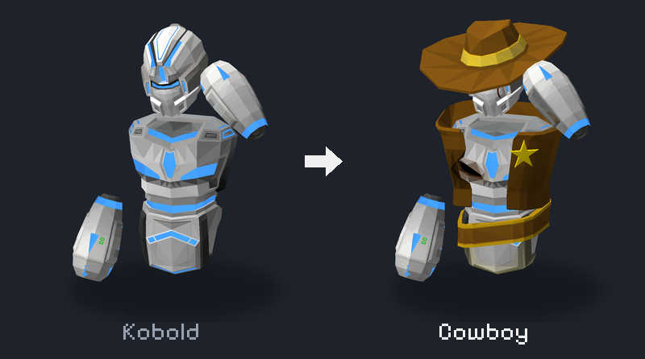
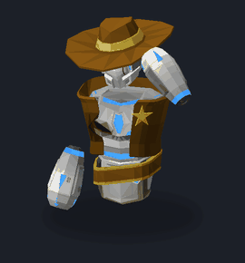
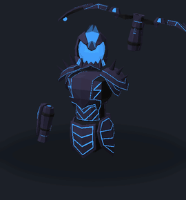
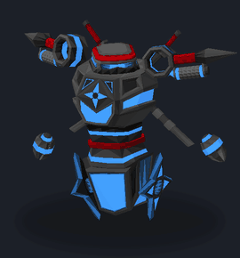
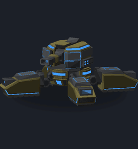
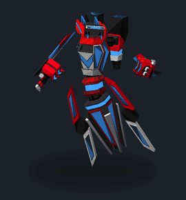
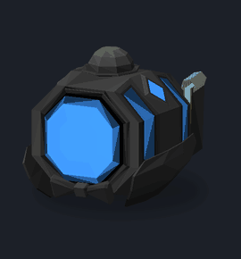

# Skins

  

**🇷🇺 Русская версия ниже — [перейти](#русский)**

> New models for DUST characters. Other players with the mod see them too.

### ⬇️ [Download for PC](https://github.com/LolegRus/Skins/releases/latest/download/Skins.dll) · [Download for Quest](https://github.com/LolegRus/Skins/releases/latest/download/Skins.qmod) · 💬 [Discord](https://discord.gg/KM5YC5FjH)

  

<table align="center">
  <tr>
    <td align="center"> <b>Cowboy</b> Kobold</td>
    <td align="center"> <b>Dark Knight</b> Sparrow</td>
    <td align="center"> <b>Ninja</b> Grappler</td>
  </tr>
  <tr>
    <td align="center"> <b>Heavy Machinery</b> Scarab</td>
    <td align="center"> <b>Neo</b> Jacket</td>
    <td align="center"> <b>Detective</b> Drone</td>
  </tr>
</table>

## What it is

- The mod changes how your character looks.
- Every class has its own skins. Pick one in the menu — the mod remembers it.
- Players with the mod see your skin, and you see theirs. On PC and on Quest.
- Your team color stays.

## Skins

The mod comes with 13 skins. All the models are made by **Cinder**.

| Skin | Class | | Skin | Class |
|---|---|---|---|---|
| Cowboy | Kobold | | Hound | Assassin |
| Dark Knight | Sparrow | | Sunset | Crossbolt |
| Enforcer | Roller | | Heavy Machinery | Scarab |
| Gear | Reaper | | Nerd | Boulder |
| Code Breaker | Seraph | | Neo | Jacket |
| Ninja | Grappler | | Detective | Drone |
| Observatory-49 | Golem | | | |

On PC you can only play Scarab and Drone. You see the other classes' skins on players in VR headsets.

## Installation

### PC

1. Get [MelonLoader](https://github.com/LavaGang/MelonLoader/releases) 0.7.x. Run its installer, pick `Dust.exe` and press **Install**.
2. Start the game once, then close it.
3. Download [Skins.dll](https://github.com/LolegRus/Skins/releases/latest/download/Skins.dll) and put it into the game's `Mods` folder.
4. Start the game. In the black window you should see **Skins v0.7.0** — that means it works!

> Red lines about **OpenXR** in the black window are normal.

### Meta Quest (no PC)

You only need a computer once — to install the mod. You also need a USB cable and DUST on the headset.

1. **Turn on developer mode.** On your phone: the **Meta Horizon** app → **Menu** → **Devices** → your headset →
   **Headset settings** → **Developer mode**. If it asks you to create an organization,
   make one at [developers.meta.com](https://developers.meta.com/horizon/manage/organizations/create/) — it's free.
2. **Plug the headset** into the computer and put it on. In "Allow USB debugging?" tick
   **Always allow from this computer** and press **Allow**.
3. **Download [QuestPatcher](https://github.com/Lauriethefish/QuestPatcher/releases/latest/download/QuestPatcher-windows-standalone.zip)**, unzip it and run `QuestPatcher.exe`.
4. **Pick DUST:** **Tools & Options** tab → **Change App** → `org.VRDojo.Dust`.
5. **Patch the game:** **Patching** tab → mod loader **Scotland2** → **Patch my app!** Wait a couple of minutes, keep the cable in.
6. **Download [Skins.qmod](https://github.com/LolegRus/Skins/releases/latest/download/Skins.qmod)** and drag it into the QuestPatcher window.
7. **Done!** Unplug the cable and start DUST in the headset.

> If DUST updates, do step 5 again. You don't need to install the mod again.

## Controls

| | PC | Quest |
|---|---|---|
| Open the menu | F2 | Press the left stick |
| Put on a skin | Click or 1–4 | Point the right controller and pull the trigger |
| Another page | ← → | Arrows at the bottom of the menu |

The first button in the menu is the normal look without a skin.

## Help

Something doesn't work, or you have an idea? Write to us on [Discord](https://discord.gg/KM5YC5FjH).

---

## Русский

> Новые модели для персонажей DUST. Их видят и другие игроки с модом.

### ⬇️ [Скачать для ПК](https://github.com/LolegRus/Skins/releases/latest/download/Skins.dll) · [Скачать для Quest](https://github.com/LolegRus/Skins/releases/latest/download/Skins.qmod) · 💬 [Discord](https://discord.gg/KM5YC5FjH)

## Что это

- Мод меняет вид твоего персонажа на скин.
- У каждого класса свои скины. Выбираешь в меню — мод запомнит.
- Игроки с модом видят твой скин, а ты их. И на ПК, и на Quest.
- Цвет команды остаётся.

## Скины

В моде уже есть 13 скинов. Все модели сделал **Cinder**.

| Скин | Класс | | Скин | Класс |
|---|---|---|---|---|
| Cowboy | Kobold | | Hound | Assassin |
| Dark Knight | Sparrow | | Sunset | Crossbolt |
| Enforcer | Roller | | Heavy Machinery | Scarab |
| Gear | Reaper | | Nerd | Boulder |
| Code Breaker | Seraph | | Neo | Jacket |
| Ninja | Grappler | | Detective | Drone |
| Observatory-49 | Golem | | | |

На ПК можно играть только за Scarab и Drone. Скины других классов видно на игроках в VR-шлеме.

## Установка

### ПК

1. Скачай [MelonLoader](https://github.com/LavaGang/MelonLoader/releases) 0.7.x. Запусти установщик, выбери `Dust.exe` и нажми **Install**.
2. Запусти игру один раз и закрой.
3. Скачай [Skins.dll](https://github.com/LolegRus/Skins/releases/latest/download/Skins.dll) и положи его в папку игры `Mods`.
4. Запусти игру. В чёрном окне появится **Skins v0.7.0** — значит, всё работает!

> Красные строки про **OpenXR** в чёрном окне — это нормально.

### Meta Quest (без ПК)

Компьютер нужен только один раз — чтобы поставить мод. Ещё понадобятся USB-кабель и DUST на шлеме.

1. **Включи режим разработчика.** В телефоне: приложение **Meta Horizon** → **Menu** → **Devices** → твой шлем →
   **Headset settings** → **Developer mode**. Если просит создать организацию —
   создай её на [developers.meta.com](https://developers.meta.com/horizon/manage/organizations/create/), это бесплатно.
2. **Подключи шлем** кабелем к компьютеру и надень его. В окне «Allow USB debugging?» поставь галочку
   **Always allow from this computer** и нажми **Allow**.
3. **Скачай [QuestPatcher](https://github.com/Lauriethefish/QuestPatcher/releases/latest/download/QuestPatcher-windows-standalone.zip)**, распакуй и запусти `QuestPatcher.exe`.
4. **Выбери DUST:** вкладка **Tools & Options** → **Change App** → `org.VRDojo.Dust`.
5. **Пропатчи игру:** вкладка **Patching** → загрузчик **Scotland2** → **Patch my app!** Подожди пару минут, кабель не отключай.
6. **Скачай [Skins.qmod](https://github.com/LolegRus/Skins/releases/latest/download/Skins.qmod)** и перетащи его в окно QuestPatcher.
7. **Готово!** Отключи кабель и запусти DUST в шлеме.

> Если DUST обновится, повтори шаг 5. Мод заново ставить не нужно.

## Управление

| | ПК | Quest |
|---|---|---|
| Открыть меню | F2 | Нажми левый стик |
| Надеть скин | Клик или 1–4 | Наведи правый контроллер и нажми курок |
| Другая страница | ← → | Стрелки внизу меню |

Первая кнопка в меню — обычный вид без скина.

## Помощь

Что-то не работает или есть идея? Пиши в [Discord](https://discord.gg/KM5YC5FjH).

---

Made by **LolegRus** · skin models by **Cinder**
